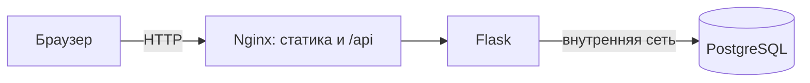

# Лабораторные по DevOps

В этом репозитории один сервис используется в лабораторных по DevOps. Здесь находятся код и отчёты; условия преподавателя лежат в папке предмета, вне Git-root.

## Быстрый старт

Нужен Docker Desktop с Docker Compose. Сохраните репозиторий в папке с ASCII-именем, например `clouds-labs`: в проверенной среде совместная сборка двух сервисов из папки `Практика` завершалась ошибкой BuildKit `x-docker-expose-session-sharedkey`. После переименования обычный Compose build работает.

Создайте локальные настройки и материалы для самоподписанного TLS/basic auth, затем поднимите сервисы:

```sh
cp .env.example .env
# Откройте .env и задайте собственный локальный POSTGRES_PASSWORD.
./scripts/lab-01-setup-local.sh
docker compose up --build -d
docker compose ps
```

Откройте <http://localhost:8080>: Nginx перенаправит на HTTPS-порт 8443. Сертификат самоподписанный, поэтому браузер покажет локальное предупреждение. Проверка API без браузера:

```sh
curl -kfsS https://localhost:8443/healthz
```

Для остановки контейнеров и сохранения данных:

```sh
docker compose down
```

`docker compose down -v` удаляет именованный том с данными. Версия, проверенная для ЛР0, зафиксирована в [коммите `1c7c8d7`](https://github.com/fadeeey/clouds-labs/commit/1c7c8d7); там же сохранены отдельные команды запуска ЛР0. Эта инструкция описывает текущий трёхсервисный Compose-стек.

## Текущая архитектура

В текущей конфигурации Nginx отдаёт HTML/CSS/JS по HTTPS и распределяет `/api` между двумя Flask-контейнерами; оба backend обращаются к PostgreSQL по внутренней сети. В исходной ЛР0 интерфейс и backend были в одном процессе — детали и воспроизводимые команды сохранены в [версии commit `1c7c8d7`](https://github.com/fadeeey/clouds-labs/commit/1c7c8d7). Следующие работы добавят проверку уязвимостей, CI/CD и откат.



## Маршрут и состояние

Работы расположены в выбранном порядке. Статус выполнения и статус приёмки указаны отдельно.

| Работа | Тема | Выполнение | Приёмка |
|---|---|---|---|
| ЛР0 | Свой сервис | Проверено локально | Не отправлено |
| ЛР2 | Docker и Compose | Проверено локально | Не отправлено |
| ЛР2* | Самовосстановление и лимиты | Проверено локально | Не отправлено |
| ЛР1 | Nginx и два backend | Проверено локально | Не отправлено |
| ЛР1* | Проверка конфигурации Nginx | Проверено локально | Не отправлено |
| ЛР3 | CI/CD | Проверено локально и в GitHub Actions | Не отправлено |
| ЛР3* | Rollback | В работе | Не отправлено |

Облачный трек отдельный и выполняется во второй половине семестра; сейчас он вне объёма.

## Лаба 0

- [Отчёт ЛР0](labs/lab-00/report.md) — фактическая проверка интерфейса, API, PostgreSQL и сохранения данных.
- [Как запустить ЛР0](labs/lab-00/README.md) — пошаговая инструкция и команды.
- [Скриншот приложения с сохранённой задачей](labs/lab-00/evidence/app-created-task.png).

Задача в отчётном примере добавлена через реальный интерфейс; изображение снято после обновления страницы. Скриншоты следующих работ появятся только после их реального запуска.

## Лаба 2

- [Отчёт ЛР2](labs/lab-02/report.md) — размеры образов, замер повторной сборки и реальные проверки Compose.
- [Запуск и устройство ЛР2](labs/lab-02/README.md).

## Лаба 2*

- [Отчёт ЛР2*](labs/lab-02-star/report.md) — восстановление PostgreSQL, лимиты и наблюдения под ограниченной нагрузкой.
- [Фактические команды и замеры](labs/lab-02-star/evidence/runtime-checks.txt).

## Лаба 1

- [Отчёт ЛР1](labs/lab-01/report.md) — HTTPS, два backend, rate limit и проверка отказа одного экземпляра.
- [Локальный запуск и тесты](labs/lab-01/README.md).
- [Скриншот приложения по HTTPS](labs/lab-01/evidence/app-https.png).

## Лаба 1*

- [Отчёт ЛР1*](labs/lab-01-star/report.md) — три контролируемые проверки на собственном изолированном Nginx-стенде и соответствующие проверки основного конфига.
- [Запуск локального стенда](labs/lab-01-star/README.md); скрипт после тестов удаляет свой контейнер и сеть.

## Лаба 3

- [Отчёт ЛР3](labs/lab-03/report.md) — hosted CI, приватный GHCR, сканирование обоих образов, реальный deploy smoke test и негативные gates.
- [Успешный run](https://github.com/fadeeey/clouds-labs/actions/runs/39496839618); workflow-run временный, преподавателю не отправлено.

## Лаба 3*

- [Отчёт ЛР3*](labs/lab-03-star/report.md) — один hosted run с публикацией, контролируемым отказом frontend и откатом.
