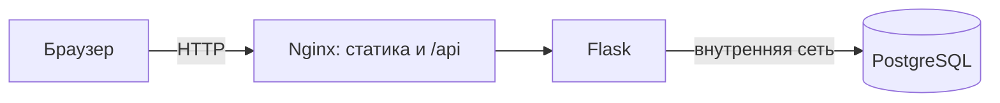

# Лабораторные по DevOps

В этом репозитории один сервис используется в лабораторных по DevOps. Здесь находятся код и отчёты; условия преподавателя лежат в папке предмета, вне Git-root.

## Быстрый старт

Нужен Docker Desktop с Docker Compose. Сохраните репозиторий в папке с ASCII-именем, например `clouds-labs`: в проверенной среде совместная сборка двух сервисов из папки `Практика` завершалась ошибкой BuildKit `x-docker-expose-session-sharedkey`. После переименования обычный Compose build работает.

Создайте локальный файл настроек и поднимите сервисы:

```sh
cp .env.example .env
# Откройте .env и задайте собственный локальный POSTGRES_PASSWORD.
docker compose up --build -d
docker compose ps
```

Откройте <http://127.0.0.1:8080>, добавьте задачу и обновите страницу. Проверка состояния backend:

```sh
curl -fsS http://127.0.0.1:5001/health
```

Для остановки контейнеров и сохранения данных:

```sh
docker compose down
```

`docker compose down -v` удаляет именованный том с данными. Версия, проверенная для ЛР0, зафиксирована в [коммите `1c7c8d7`](https://github.com/fadeeey/clouds-labs/commit/1c7c8d7); там же сохранены отдельные команды запуска ЛР0. Эта инструкция описывает текущий трёхсервисный Compose-стек.

## Текущая архитектура

В текущей конфигурации Nginx отдаёт HTML/CSS/JS и передаёт `/api` в Flask; Flask работает отдельным контейнером и обращается к PostgreSQL по внутренней сети. В исходной ЛР0 интерфейс и backend были в одном процессе — детали и воспроизводимые команды сохранены в [версии commit `1c7c8d7`](https://github.com/fadeeey/clouds-labs/commit/1c7c8d7). Следующие работы добавят балансировку, CI/CD и откат.



## Маршрут и состояние

Работы расположены в выбранном порядке. Статус выполнения и статус приёмки указаны отдельно.

| Работа | Тема | Выполнение | Приёмка |
|---|---|---|---|
| ЛР0 | Свой сервис | Проверено локально | Не отправлено |
| ЛР2 | Docker и Compose | Проверено локально | Не отправлено |
| ЛР2* | Самовосстановление и лимиты | Не начата | Не отправлено |
| ЛР1 | Nginx и два backend | Не начата | Не отправлено |
| ЛР1* | Проверка уязвимостей | Не начата | Не отправлено |
| ЛР3 | CI/CD | Не начата | Не отправлено |
| ЛР3* | Rollback | Не начата | Не отправлено |

Облачный трек отдельный и выполняется во второй половине семестра; сейчас он вне объёма.

## Лаба 0

- [Отчёт ЛР0](labs/lab-00/report.md) — фактическая проверка интерфейса, API, PostgreSQL и сохранения данных.
- [Как запустить ЛР0](labs/lab-00/README.md) — пошаговая инструкция и команды.
- [Скриншот приложения с сохранённой задачей](labs/lab-00/evidence/app-created-task.png).

Задача в отчётном примере добавлена через реальный интерфейс; изображение снято после обновления страницы. Скриншоты следующих работ появятся только после их реального запуска.

## Лаба 2

- [Отчёт ЛР2](labs/lab-02/report.md) — размеры образов, замер повторной сборки и реальные проверки Compose.
- [Запуск и устройство ЛР2](labs/lab-02/README.md).
