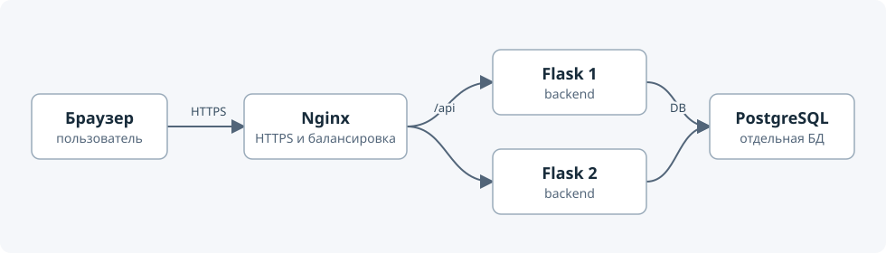
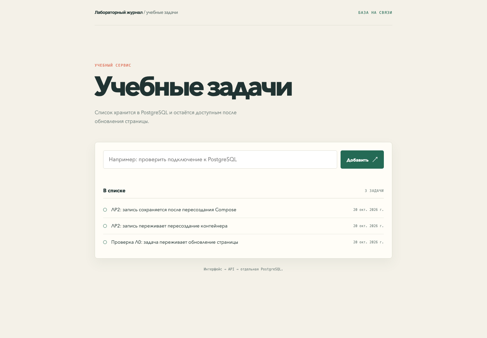
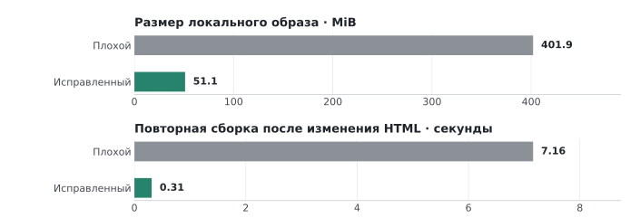

# DevOps · лабораторный журнал

Flask-приложение с PostgreSQL: два backend за Nginx, контейнерная сборка, проверки CI и откат релиза.

[Устройство](#устройство) · [Результаты](#результаты) · [Запуск](#запуск) · [Отчёты](#отчёты)

## Устройство



Nginx принимает HTTPS; backend делят одну PostgreSQL, данные хранятся в именованном томе.

<details>
<summary>Интерфейс приложения</summary>



</details>

## Результаты



Один ARM64-замер на ревизии [`e4e356f`](https://github.com/fadeeey/clouds-labs/tree/e4e356f): `.Size` локального образа и повторная сборка после изменения HTML. [Методика и исходные значения](labs/lab-02/report.md). Одна точка в HTML заставила плохую сборку установить зависимости заново.

### CI и откат

Схема pipeline: `lint → PostgreSQL tests → build → Trivy → GHCR → deploy smoke`.

- Негативный тест завершился ошибкой; build и deploy были пропущены в [run #39495954222](https://github.com/fadeeey/clouds-labs/actions/runs/39495954222).
- Образ с 16 Critical остановил публикацию и deploy в [run #39496087533](https://github.com/fadeeey/clouds-labs/actions/runs/39496087533). В обычных образах Critical — 0; остаются 48 High у backend и 45 High у frontend. Четыре Python-находки backend не разрешены; детали и ограничения сканирования — в [отчёте ЛР3](labs/lab-03/report.md).

| Рабочий релиз | Неисправный frontend | Откат |
|---|---|---|
| HTTP 200 | HTTP 503, unhealthy | HTTP 200 |
| Контрольная запись с id=1 | Тот же том БД | Та же запись с id=1 |

0,552 с от команды отката до восстановления health и контрольной записи — в [run #39499120264](https://github.com/fadeeey/clouds-labs/actions/runs/39499120264). Hosted deployment временный: после smoke test стенд очищается.

## Запуск

Нужен Docker Desktop с Docker Compose. Локальные сертификат и Basic Auth создаются в `.local/nginx/`, эта папка исключена из Git.

```sh
cp .env.example .env
# Замените POSTGRES_PASSWORD локальным паролем.
./scripts/lab-01-setup-local.sh
docker compose up --build --wait -d
```

Откройте <https://localhost:8443>. Сертификат самоподписанный. Готовность API и PostgreSQL: `curl -kfsS https://localhost:8443/healthz`.

```sh
docker compose down
```

Не добавляйте `-v`, если нужно сохранить данные в именованном томе PostgreSQL.

## Отчёты

| Работа | Тема | Отчёт |
|---|---|---|
| ЛР0 | Приложение и отдельная PostgreSQL | [Отчёт](labs/lab-00/report.md) |
| ЛР2 | Dockerfile, кэш и Compose | [Отчёт](labs/lab-02/report.md) |
| ЛР2* | Восстановление и ограниченная нагрузка | [Отчёт](labs/lab-02-star/report.md) |
| ЛР1 | HTTPS, балансировка и доступ | [Отчёт](labs/lab-01/report.md) |
| ЛР1* | Проверки безопасности стенда | [Отчёт](labs/lab-01-star/report.md) |
| ЛР3 | CI, Trivy и deployment | [Отчёт](labs/lab-03/report.md) |
| ЛР3* | Откат опубликованного релиза | [Отчёт](labs/lab-03-star/report.md) |
