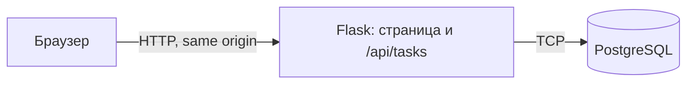

# Лабораторные по DevOps

В этом репозитории один сервис используется в лабораторных по DevOps. Здесь находятся код и отчёты; условия преподавателя лежат в папке предмета, вне Git-root.

## Быстрый старт

Нужен Docker Desktop с Docker Compose и Python 3. Создайте локальный файл настроек и запустите отдельную PostgreSQL:

```sh
cp .env.example .env
# Откройте .env и задайте собственный локальный POSTGRES_PASSWORD.
docker compose up -d db
docker compose ps
```

В другом терминале из корня репозитория поднимите backend:

```sh
python3 -m venv .venv
source .venv/bin/activate
pip install -r requirements.txt
set -a && source .env && set +a
python app/backend/server.py
```

Откройте <http://127.0.0.1:5000>, добавьте задачу и обновите страницу. Проверка соединения интерфейса и backend с PostgreSQL:

```sh
curl -fsS http://127.0.0.1:5000/health
```

Остановить backend можно через `Ctrl+C`, базу — командой `docker compose down`. Обычная остановка сохраняет именованный том; `docker compose down -v` удаляет его вместе с данными.

## Текущая архитектура

В ЛР0 интерфейс состоит из HTML/CSS/JS-файлов, Flask отдаёт страницу и HTTP API, PostgreSQL работает отдельно. Это три части приложения, но frontend пока не отдельный процесс. Nginx, несколько копий backend, контейнеризация приложения и CI/CD добавятся в следующих лабораторных.



## Маршрут и состояние

Работы расположены в выбранном порядке. Статус выполнения и статус приёмки указаны отдельно.

| Работа | Тема | Выполнение | Приёмка |
|---|---|---|---|
| ЛР0 | Свой сервис | Проверено локально | Не отправлено |
| ЛР2 | Docker и Compose | Не начата | Не отправлено |
| ЛР2* | Самовосстановление и лимиты | Не начата | Не отправлено |
| ЛР1 | Nginx и два backend | Не начата | Не отправлено |
| ЛР1* | Проверка уязвимостей | Не начата | Не отправлено |
| ЛР3 | CI/CD | Не начата | Не отправлено |
| ЛР3* | Rollback | Не начата | Не отправлено |

Облачный трек отдельный и выполняется во второй половине семестра; сейчас он вне объёма.

## Лаба 0

- [Отчёт ЛР0](labs/lab-00/report.md) — фактическая проверка интерфейса, API, PostgreSQL и сохранения данных.
- [Как запустить ЛР0](labs/lab-00/README.md) — пошаговая инструкция и команды.
- [Скриншот приложения с сохранённой задачей](labs/lab-00/evidence/app-created-task.png).

Задача в отчётном примере добавлена через реальный интерфейс; изображение снято после обновления страницы. Скриншоты следующих работ появятся только после их реального запуска.
