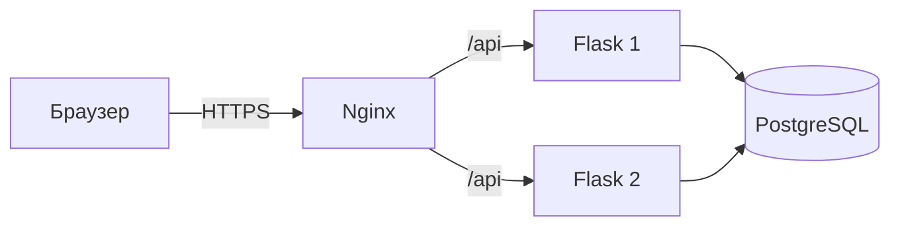

# DevOps

Журнал учебных задач проходит через лабораторные по Flask, PostgreSQL, Docker, Nginx и CI/CD.


## Быстрый запуск

Нужен Docker Desktop с Docker Compose. Рабочую копию держите в каталоге с ASCII-именем, например `clouds-labs`: в этой среде совместная сборка сервисов из каталога с кириллицей завершалась ошибкой BuildKit `x-docker-expose-session-sharedkey`; после перехода в каталог `clouds-labs` сборка прошла.

```sh
cp .env.example .env
# Замените POSTGRES_PASSWORD на локальный пароль.
./scripts/lab-01-setup-local.sh
docker compose up --build --wait -d
```

Откройте <https://localhost:8443>. Сертификат самоподписанный, поэтому браузер покажет предупреждение. Готовность API и PostgreSQL можно проверить командой `curl -kfsS https://localhost:8443/healthz`. Остановить контейнеры, сохранив базу:

```sh
docker compose down
```

Не добавляйте `-v`, если нужно сохранить данные PostgreSQL в именованном томе.

## Устройство

Nginx раздаёт статический интерфейс и распределяет запросы API между двумя Flask backend. Оба backend подключаются к отдельной PostgreSQL по внутренней сети.



## Лабораторные

| Работа | Что проверено | Отчёт и доказательства |
|---|---|---|
| ЛР0 | Интерфейс, API и отдельная PostgreSQL; запись осталась после обновления страницы. | [Отчёт](labs/lab-00/report.md) · [скриншот](labs/lab-00/evidence/app-created-task.png) · [воспроизводимая версия `1c7c8d7`](https://github.com/fadeeey/clouds-labs/commit/1c7c8d7) |
| ЛР2 | Плохой и исправленный Dockerfile, cache, multi-stage, non-root и Compose из трёх сервисов. Исторические замеры привязаны к ревизии `e4e356f`. | [Отчёт](labs/lab-02/report.md) · [инструкции той ревизии](https://github.com/fadeeey/clouds-labs/blob/e4e356f/labs/lab-02/README.md) |
| ЛР2* | Восстановление соединения с БД и ограниченная проверка CPU/RAM на изолированном стенде. | [Отчёт](labs/lab-02-star/report.md) · [фактические замеры](labs/lab-02-star/evidence/runtime-checks.txt) |
| ЛР1 | HTTPS, два backend, балансировка, закрытый `/admin` и отдельный DNS-check при смене адреса backend. | [Отчёт](labs/lab-01/report.md) · [скриншот](labs/lab-01/evidence/app-https.png) · [HTTP-проверки](scripts/lab-01-check.sh) · [DNS-fixture](scripts/lab-01-dns-check.sh) |
| ЛР1* | Три проверки на собственном Nginx-стенде с фиктивными файлами; внешний трафик и реальные секреты не использовались. | [Отчёт](labs/lab-01-star/report.md) · [вывод проверок](labs/lab-01-star/evidence/check-output.txt) |
| ЛР3 | GitHub Actions: lint и тесты, сборка двух образов, Trivy и Critical gate, публикация в GHCR и временный deploy smoke test. | [Отчёт](labs/lab-03/report.md) · [успешный run](https://github.com/fadeeey/clouds-labs/actions/runs/39495550006) · [test gate](https://github.com/fadeeey/clouds-labs/actions/runs/39495954222) · [Critical gate](https://github.com/fadeeey/clouds-labs/actions/runs/39496087533) |
| ЛР3* | В одном hosted run неисправная версия вернула 503; одна команда восстановила рабочий digest и ту же запись в БД. | [Отчёт](labs/lab-03-star/report.md) · [rollback run](https://github.com/fadeeey/clouds-labs/actions/runs/39499120264) · [лог job](https://github.com/fadeeey/clouds-labs/actions/runs/39499120264/job/118891789228) |

## Границы проверок

- GitHub-hosted deployment одноразовый: после smoke test его контейнеры и данные удаляются. Постоянный публичный сервис не создавался.
- В опубликованных CI-образах проверены уровни Critical и High: 0 Critical; backend — 48 High (44 Debian и 4 Python), frontend — 45 High. Четыре Python finding остаются неразрешёнными; scope и ограничения Trivy SBOM описаны в [отчёте ЛР3](labs/lab-03/report.md). Средние и низкие уровни workflow не сканирует.
- Локальные сертификат и Basic Auth создаются в `.local/nginx/`, исключённом из Git. Это только локальные файлы для учебного стенда.
- Измеренное восстановление в rollback run — 0,552 с на одной GitHub-hosted VM; это результат конкретного прогона, не обещание SLA.
- Отчёты ЛР0 и ЛР1 содержат настоящие снимки интерфейса. Остальные доказательства привязаны к записям команд и Actions runs в соответствующих отчётах.

Условия курса остаются в папке предмета вне Git-репозитория. Облачный трек выполняется отдельно во второй половине семестра.
