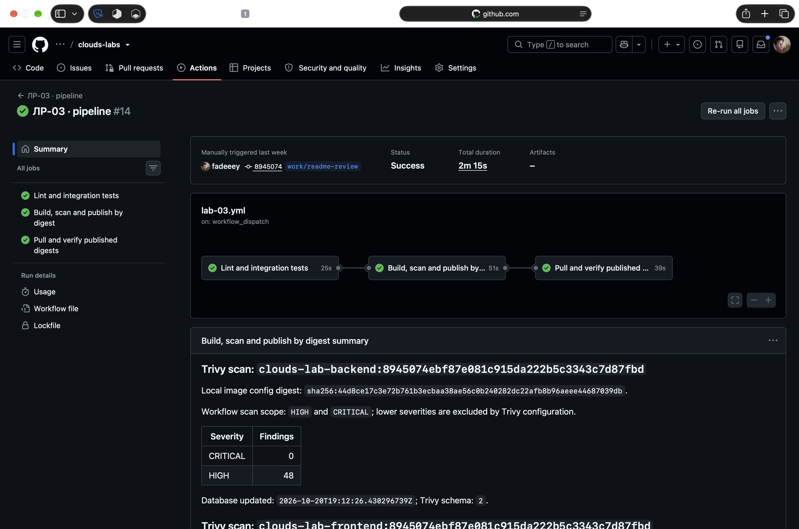

# ЛР3 — CI/CD, сканирование и deployment

Нужно провести изменение через проверки, сборку, сканирование и публикацию, а затем отдельно развернуть опубликованные образы. Зелёный результат должен означать, что обязательные этапы действительно пройдены. Для проверки этого свойства понадобились и успешные runs, и два намеренно неуспешных.

## Схема pipeline

Workflow `.github/workflows/lab-03.yml` выполняет lint и интеграционные тесты с PostgreSQL, собирает backend и frontend, сканирует оба образа закреплённым Trivy и публикует их в приватный GHCR только после прохождения Critical gate. Следующая job отдельно выполняет `docker compose pull` по registry digest, запускает изолированный стенд и проверяет готовность API и запись задачи.

Workflow использует GitHub-hosted `ubuntu-24.04-arm`, чтобы собирать и запускать ARM64 образы. Deploy job получает отдельную одноразовую VM; она не хранит состояние предыдущих запусков. Compose-проект, порт и volume имеют собственные имена; после проверки job удаляет только созданный им стенд. Основные локальные сервисы и их PostgreSQL volume не затрагиваются.

В `.github/workflows/lab-03-bad.yml` оставлен демонстрационный плохой pipeline: плавающая ссылка на checkout action, Dockerfile без зафиксированной версии и без тестов, cache и security gate. Он не публикует образы и не запускает deployment.

## Локальная проверка до GitHub run

| Проверка | Наблюдение | Доказательство |
|---|---|---|
| Ruff | `All checks passed!` | `ruff check app tests scripts/lab-03` |
| Интеграционные тесты | 3/3 прошли с настоящей PostgreSQL | `python -m unittest discover -s tests -v` внутри контейнера в Compose-сети `cloud-labs_database` |
| Изолированный deployment Compose | `up --no-build` запустил db/backend/frontend; `/healthz` вернул 200; POST→GET нашёл созданную запись | временный проект `l3-smoke`, отдельный volume удалён после проверки |
| Workflow/YAML | `actionlint` завершился с кодом 0; Compose-файл прошёл `docker compose config -q` | локальные команды до публикации ветки |

Запуск тестов с macOS-хоста к БД курса не состоялся: контейнер доступен только внутри Docker-сети, host-порт не опубликован. Тесты не выдаются за проверку host-подключения; корректный путь — запуск тестового процесса в той же контейнерной сети.

## Локальное сравнение уязвимостей

Trivy 0.74.0 использовал базу, обновлённую `2026-10-20T19:12:26Z`. Оба образа собраны под `linux/arm64`; digest ниже — локальный image config ID, а не registry manifest digest.

| Снимок backend | Базовый образ | Локальный image config ID | Critical | High |
|---|---|---|---:|---:|
| До обновления, Debian 12 | `python:3.14-slim-bookworm` | `sha256:d76b54540fbd7d7ffa0c0ec0c48c6ae428cab83b4887d8b97238f9cd31926f92` | 2 | 65 |
| После перехода, Debian 13 | `python:3.14-slim-trixie` | `sha256:dd15057d4af0da1c4a43778dbd353c4e48e41e13865a52cd911a15598eecf38f` | 0 | 48 |

Два исходных Critical finding в Bookworm были без доступной `FixedVersion`: `libsqlite3-0 3.40.1-2+deb12u2` (`CVE-2025-7458`) и `zlib1g 1:1.2.13.dfsg-1` (`CVE-2023-45853`). Для одного обоснованного исправления заменён закреплённый multi-arch base digest на официальный `python:3.14-slim-trixie`; повторный локальный scan показал 0 Critical. Это результат конкретного scan, не гарантия отсутствия уязвимостей в будущей базе.

На Trixie остаются 44 Debian High и 4 Python High. В Python target Trivy перечислил `msgpack 1.1.2 → 1.2.1` (`GHSA-6v7p-g79w-8964`), `setuptools 70.3.0 → 78.1.1` (`CVE-2025-47273`) и `urllib3 2.7.0 → 2.8.0` (`CVE-2026-97687`, `CVE-2026-97689`). JSON сообщает `Class=lang-pkgs`, `Type=python-pkg`, `PkgPath=null`, `Layer.DiffID=sha256:54d103c61570dcb43cbb7f20991a504ec35d806ec1cbb544d0ba472e888a5775`; он не даёт пути к SBOM или связи с конкретным установленным файлом. `pip list` внутри runtime image не показывает эти три дистрибутива, но это наблюдение само по себе не доказывает отсутствие вложенного компонента. Поэтому 4 finding оставлены неустранёнными, без игнорирования и без заявления, что весь образ чистый.

Trivy предупреждает, что сторонние SBOM могут давать неточные результаты; это контекст для дальнейшей проверки, а не основание убрать находки из отчёта. [Документация Trivy о сканировании контейнеров](https://trivy.dev/docs/v0.74/guide/target/container_image/).

## Результат hosted run

[Первый run #39494604671](https://github.com/fadeeey/clouds-labs/actions/runs/39494604671) завершил проверки, сборку, scan и публикацию, но deploy завершился с `curl: (56) Recv failure: Connection reset by peer` сразу после старта frontend-контейнера. В workflow добавил ограниченные повторные попытки для временных curl-ошибок и вывод логов frontend при окончательном сбое. [Run #2](https://github.com/fadeeey/clouds-labs/actions/runs/39495048433) завершился успешно за 2 мин 15 с. На [run #3](https://github.com/fadeeey/clouds-labs/actions/runs/39495550006) уже с исправленным отображением manifest refs тоже успешно прошли все три job: оба образа прошли Critical gate, deploy job отдельно скачал опубликованные манифесты по digest, проверил `/healthz` и выполнил API POST→GET для контрольной записи. Это доказывает проверку временного hosted стенда; публичный постоянно доступный сервис не создавался.

| Опубликованный образ, run #39495550006 | Registry manifest digest | Локальный image config ID | Critical / High |
|---|---|---|---:|
| Backend | `sha256:324266ac76363633c1f06bed23ee9e4841dd2a806624abadea6b4c8b0b967948` | `sha256:57f7c7348b129bc7c6d35aace028930b0b60eca0b4e6b091610d5427f1d9090e` | 0 / 48 |
| Frontend | `sha256:9615ba7d997bdc3c579639db2ef23934d90b3fc06105e5ed8dbd5d3a2e6d0a38` | `sha256:83f9e391292054441f4a93190ca2859300816803979e45c56cda33f2ac3f7676` | 0 / 45 |

Оба образа просканированы одним Trivy DB snapshot (`2026-10-20T19:12:26Z`). High findings остаются видимыми в summary; Critical gate настроен на обе публикуемые images и не ослаблен. GHCR publish log — источник manifest digest; локальный `docker image inspect` ID относится к конфигурации образа и не подменяет registry digest.

### Run после исправлений кода

[Run #39505104091](https://github.com/fadeeey/clouds-labs/actions/runs/39505104091) на коммите `8945074` завершился успешно за 2 мин 15 с: прошли validation, build/scan/publish и отдельный deploy по digest. Summary показал 0 Critical / 48 High у backend и 0 Critical / 45 High у frontend. В [сохранённом выводе deployment job](evidence/2026-10-28-ci-deployment-log.txt), прочитанном 28 октября из реального раскрытого шага Actions, есть ответ `{"database":"ok","status":"ok"}` и строка `health + POST + GET verified for ci-39505104091-1`. Перед успешным повтором в том же выводе зафиксирован `curl: (52) Empty reply from server`; workflow обрабатывает такую временную ошибку ограниченными повторными попытками. Текстовый файл содержит наблюдаемый вывод, а не снимок экрана.

Скриншот GitHub Actions, сделанный 29 октября 2026 года: run #14 на коммите `8945074` — Success; все три job завершились успешно.

## Проверки защитных gates

На отдельной ветке [`work/lab-03-negative-test`](https://github.com/fadeeey/clouds-labs/tree/work/lab-03-negative-test) run [#39495954222](https://github.com/fadeeey/clouds-labs/actions/runs/39495954222) намеренно проверял неправильное ожидание `503` вместо фактического `200`. Один из трёх PostgreSQL integration tests упал с `AssertionError: 200 != 503`; job validation завершился с ошибкой, а build/publish и deploy jobs получили статус `skipped`.

В обычном ревью ожидание `503` от исправно отвечающего приложения потребовало бы исправления. В этом отдельном прогоне оно и есть контрольное повреждение. Проверяется не здоровье API, уже подтверждённое штатными тестами, а способность pipeline остановиться после ошибки.

Здесь у проверяющего возникает вредная возможность сделать всё аккуратно: заменить 503 на 200, получить зелёный run и назвать изменение «исправлением теста». Код стал бы выглядеть лучше ровно в тот момент, когда опыт перестал бы что-либо проверять. Красный прогон пришлось защищать от самой привычной формы заботы о проекте — желания немедленно его починить. Штатный workflow при этом остаётся зелёным; намеренная ошибка живёт только в отдельной отрицательной ветке.

На отдельной trusted ветке [`work/lab-03-negative-critical`](https://github.com/fadeeey/clouds-labs/tree/work/lab-03-negative-critical) run [#39496087533](https://github.com/fadeeey/clouds-labs/actions/runs/39496087533) собрал намеренно слабый backend образ из `Dockerfile.bad`. Trivy нашёл `16 Critical`; обязательный gate завершился exit 1, поэтому GHCR publish и deploy jobs были skipped. Зелёные образы в том же run отдельно имели 0 Critical (backend 48 High, frontend 45 High).

Плохой pipeline также запускался отдельно: [run #39496404487](https://github.com/fadeeey/clouds-labs/actions/runs/39496404487) успешно собрал только пример из `lab-03-bad.yml`. В нём зафиксированы плавающий `actions/checkout@v4`, отсутствие lint и integration tests, проверки cache и Trivy gate, а также отсутствие публикации и deployment. Ни одна из этих отрицательных веток не объединяется в основной рабочий branch.

## Вывод

Успешный run показал весь путь до отдельного pull по digest, health и API POST→GET на временном runner. Два отрицательных прогона подтвердили остановку после проваленного теста и после Critical findings. Bad workflow тоже собрался успешно — его зелёный цвет означал меньше, потому что обязательных проверок в нём меньше. Поэтому сравниваются выполненные этапы и причины остановки, а не оттенки галочек.

Стенд после smoke test удаляется. Gate запрещает публикацию при Critical, но не при High: 48 High у backend и 45 High у frontend остаются в отчёте. Этот результат не означает отсутствия всех уязвимостей или наличия постоянно доступного публичного сервиса.
